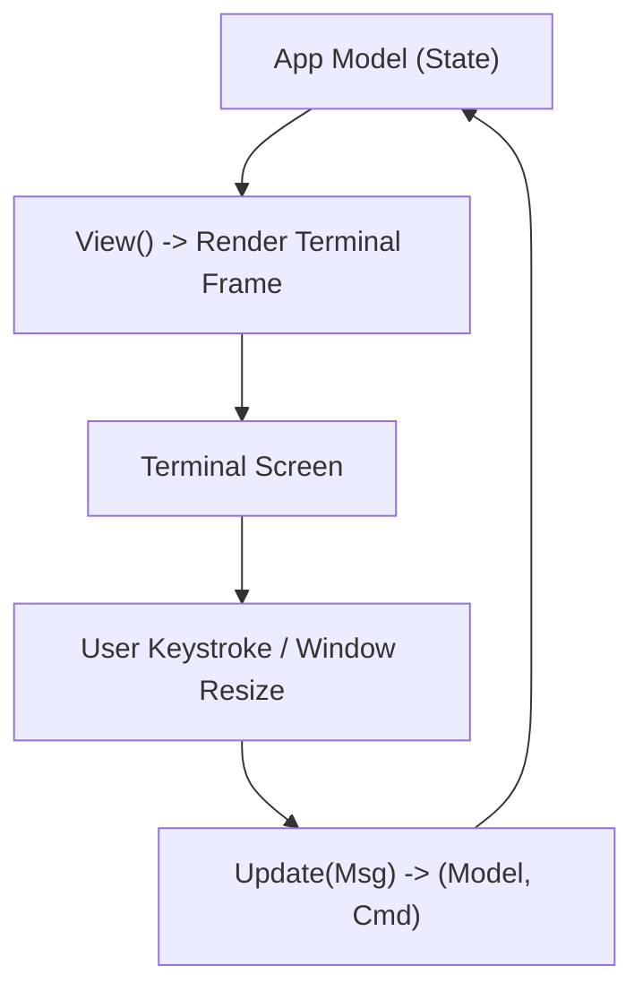

# Step 26: Full Terminal UI (TUI)

## 1. Architectural Overview

Basic terminal printing with `fmt.Println` breaks down when handling long responses, modal confirmation dialogues, live status bars, and scrollable history.

In this step, we elevate the entire user interface to a **full Terminal User Interface (TUI)** built with Charm's **Bubble Tea** (Elm architecture in Go):

```
┌───────────────────────────────────────────────────────────────┐
│ Phi Agent Code v1.0 · Model: claude-3-7-sonnet · Tokens: 4.2k │
├───────────────────────────────────────────────────────────────┤
│ [User] How many tests are passing?                            │
│                                                               │
│ [Assistant] Running go test ./...                             │
│ ✓ internal/api (0.02s)                                        │
│ ✓ internal/tool (0.04s)                                       │
│ All 14 tests passing.                                         │
│                                                               │
├───────────────────────────────────────────────────────────────┤
│ > [Type your prompt here...                                  ]│
└───────────────────────────────────────────────────────────────┘
```



## 2. Key Design Principles

- **Viewport with Scrollback**: Seamless mouse-wheel and keyboard scrolling through long model outputs.
- **Dedicated Input Box**: Bordered input textarea with multiline support and cursor movement.
- **Overlay Modals**: Permission approval diffs render in styled pop-up modals instead of messy scrolling prompts.

## 3. Implementation Requirements

1. Implement Bubble Tea `tea.Model` (`Init`, `Update`, `View`).
2. Integrate `viewport` and `textinput` components from `bubbles`.
3. Handle window resizing (`tea.WindowSizeMsg`).

## 4. Verification & Exercises

### Test 1: Full TUI Experience
Run `go run .` and verify:
- Top status header renders model name and live token counter.
- Middle viewport scrolls smoothly.
- Bottom input box accepts text with proper cursor navigation.

