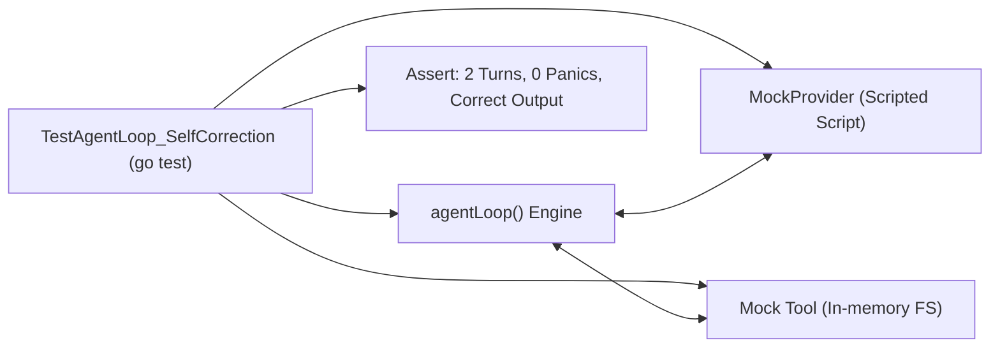

# Step 27: Harness End-to-End Testing

## 1. Architectural Overview

The true test of clean architecture is **testability**. A well-architected harness must be completely testable without internet access, without an Anthropic API key, and without creating real side effects on the developer's computer.

In this final milestone, we build an **automated test suite** that exercises the complete agent loop end-to-end using `MockProvider` and mock tools:



## 2. Key Design Principles

- **Zero Network Flakiness**: Tests run entirely offline and complete in milliseconds.
- **Contract Verification**: Verify that tools receive proper JSON inputs, errors trigger self-correction turns, and conversation history preserves alternating roles.

## 3. Implementation Requirements

1. Write `internal/agent/agent_test.go`.
2. Test scenarios:
   - Simple text response (1 turn).
   - Tool execution followed by answer (2 turns).
   - Tool error followed by self-correction (3 turns).
   - Permission rejection recovery.
   - Context compaction trigger.

## 4. Verification & Exercises

### Test 1: Running the Automated Test Suite
```bash
go test -v ./...
```

**Expected Interaction & Output:**
```text
=== RUN   TestAgentLoop_SimpleResponse
--- PASS: TestAgentLoop_SimpleResponse (0.00s)
=== RUN   TestAgentLoop_ToolExecution
--- PASS: TestAgentLoop_ToolExecution (0.01s)
=== RUN   TestAgentLoop_SelfCorrection
--- PASS: TestAgentLoop_SelfCorrection (0.01s)
=== RUN   TestPermissionGate_Rejection
--- PASS: TestPermissionGate_Rejection (0.00s)
PASS
ok      phi-agent-code/internal/agent       0.04s
```

