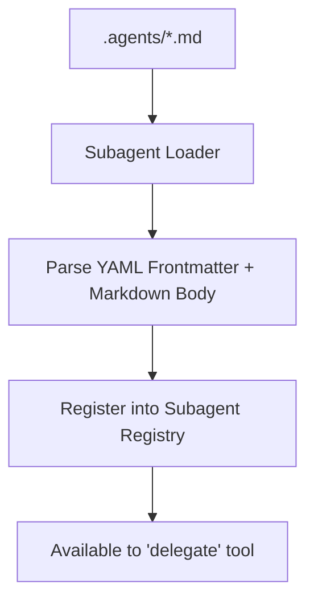

# Step 27: Markdown-Configured Subagents

## 1. Architectural Overview

Hardcoding subagent definitions in Go code requires recompiling the binary every time a developer wants a new specialized agent (e.g. `docs-writer`, `security-auditor`, `refactorer`).

In this step, we allow developers to define subagents declaratively using Markdown files with YAML frontmatter placed in `.agents/`:

```markdown
---
name: security-auditor
description: Audits code for SQL injection, hardcoded secrets, and unsafe memory operations.
tools:
  - read_file
  - grep
system_prompt: |
  You are an expert security researcher. Review provided files exclusively for security vulnerabilities.
---
```



## 2. Key Design Principles

- **Declarative Configuration**: Non-programmers can define custom agents without writing Go.
- **Tool Scoping**: Explicitly restrict which tools each subagent has access to.

## 3. Implementation Requirements

1. Scan `.agents/*.md` at startup.
2. Parse frontmatter (`name`, `description`, `tools`, `system_prompt`).
3. Instantiate and register dynamic subagents.

## 4. Verification & Exercises

### Test 1: Loading a Custom Agent
Create `.agents/tester.md`. Run `/subagents`.

**Expected Interaction & Output:**
```text
Available subagents:
  - researcher: Built-in research agent
  - tester: (loaded from .agents/tester.md)
```

