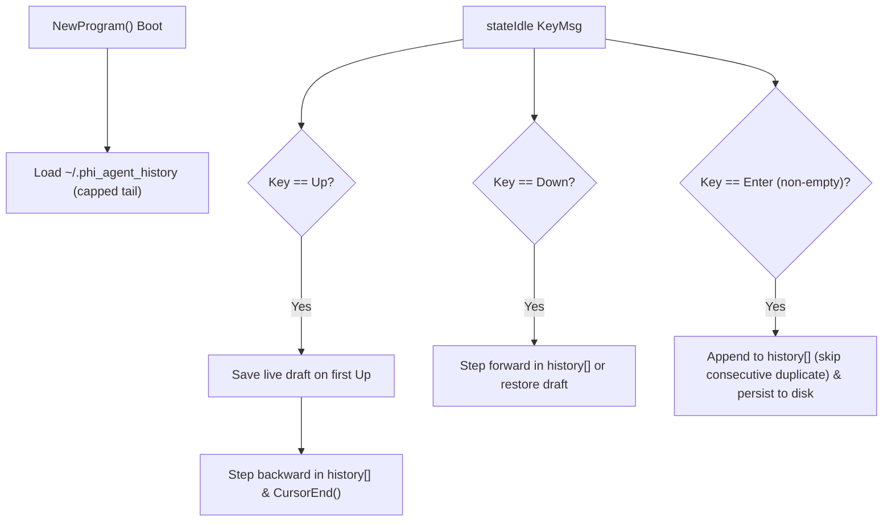

# Step 28: Persistent Input History

## 1. Architectural Overview

In Step 08, `InputReader` (`internal/ui/input.go`) gave the CLI persistent prompt history (`~/.phi_agent_history`) and `Up`/`Down` arrow recall via `chzyer/readline`. When Step 12 migrated the interactive loop to Bubble Tea (`bubbles/textinput` in `internal/ui/program.go`), `stateIdle` handled cursor editing, viewport scrolling (`PgUp`/`PgDn`/mouse wheel), and submission, but lost prompt history navigation.

In this step, we restore **TUI Prompt History Navigation & Disk Persistence** inside `internal/ui/` without reintroducing `readline`:

## 2. Key Design Principles

- **Draft Preservation Invariant**: If the user types a partial prompt (e.g., `"refactor main"`), presses `Up` to inspect an earlier prompt, and presses `Down` back past the newest history entry, their in-flight `draft` must be restored cleanly instead of being discarded.
- **Consecutive Deduplication & Cursor Positioning**: Submitting the exact same command twice in a row should not clutter `history[]`, and recalling any historical prompt must move the cursor to the end (`h.input.CursorEnd()`) so the user can edit immediately.
- **Safe Bounded Persistence (`~/.phi_agent_history`)**: Reuse the same history path convention established in `internal/ui/input.go` (gracefully falling back to in-memory-only mode if `os.UserHomeDir()` or disk writes fail—never crashing the TUI). Cap loaded/stored entries (e.g., last 500 prompts) and sanitize multi-line/control newlines so each entry stays one record per line.
- **Separation from Scrollback Navigation**: Keep `PgUp`/`PgDn`/mouse wheel scrolling the conversation `viewport` while reserving `Up`/`Down` strictly for prompt input recall in `stateIdle` (never interfering with `stateSelectingModel` arrow navigation).

## 3. Implementation Requirements

1. Add a lightweight persistence helper in `internal/ui/` (e.g., `history.go`):
   - `defaultHistoryPath() string` resolving `~/.phi_agent_history`.
   - `loadPromptHistory(path string, maxEntries int) []string` and `appendPromptHistory(path, prompt string) error` with fail-safe error handling.
2. Extend `harness` in `internal/ui/program.go` with `history []string`, `historyIdx int` (`len(history)` when editing live draft), `historyDraft string`, and `historyPath string`:
   - On `enter` in `stateIdle`: record non-empty `val` (skipping consecutive duplicate), reset `historyIdx = len(h.history)` and `historyDraft = ""`, and append to `h.historyPath`.
   - On `"up"` / `"down"` in `stateIdle`: navigate `history` safely with `SetValue(...)` and `CursorEnd()`.
3. Add deterministic unit tests in `internal/ui/program_test.go` covering `Up`/`Down` recall, live draft restoration, consecutive duplicate skipping, cursor bounds, and temporary file persistence (`t.TempDir()`).

## 4. Verification & Exercises

### Test 1: Automated TUI History Navigation & Persistence
Run `go test -v -run "TestHarnessPromptHistory|TestPromptHistoryPersistence" ./internal/ui` to verify:
- Pressing `Up` walks backward through prior submissions while preserving an unsent draft.
- Pressing `Down` past the newest entry restores the original draft verbatim.
- Consecutive identical submissions collapse cleanly and survive reload from a temp history file.

### Test 2: Cross-Session Interactive Recall
1. Launch `go run . --provider mock` and send two prompts (`first prompt`, `second prompt`).
2. Press `Up` once (`second prompt`), `Up` again (`first prompt`), then `Down` twice (back to empty/draft input).
3. Exit (`Ctrl+D`), relaunch `go run . --provider mock`, and press `Up` to verify `second prompt` was persisted in `~/.phi_agent_history`.
